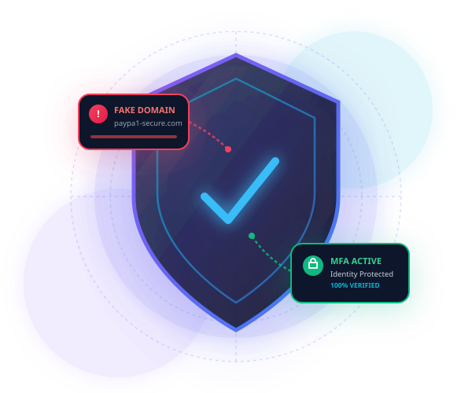

# PhishGuard — Phishing Awareness Training Website 🛡️



> **“Pause. Check. Stay Protected.”**  
> An interactive, modern cybersecurity awareness training platform engineered to educate users on detecting phishing attacks, fraudulent emails, lookalike domains, fake websites, and social engineering manipulation.

---

## 🌟 Project Overview

**PhishGuard** is a responsive web application designed for interactive defensive cybersecurity training. Every day, over 3.4 billion deceptive emails and text messages are dispatched globally, targeting individuals and organizations. PhishGuard trains users to identify red flags, analyze URL structures, understand attacker psychology, and take proactive containment actions.

---

## 🚀 Key Features

### 1. 🎓 Comprehensive Learning Modules
- **Phishing Attack Lifecycle**: Step-by-step breakdown (Reconnaissance → Bait Crafting → Delivery → Harvesting & Exploitation).
- **Phishing Attack Vectors**:
  - **Email Phishing** (Mass spam lures)
  - **Spear Phishing & Whaling** (Researched executive targeting)
  - **Smishing** (Mobile SMS phishing with malicious tracking links)
  - **Vishing** (Voice call spoofing & AI voice cloning)
  - **Clone Phishing** (Duplicating legitimate communications)
  - **Search Engine Phishing / Malvertising** (Sponsored ad hijacking)
- **Brand Impersonation Mechanisms**: Display name spoofing, typosquatting, subdomain obfuscation, and clone interfaces.

### 2. 🔍 Interactive URL Anatomy Inspector
- An interactive digital forensics sandbox allowing users to dissect URLs in real time.
- Breaks down URLs into **Protocol**, **Subdomain**, **Registered Domain (True Owner)**, and **Path**.
- Evaluates risk factors and highlights deceptive subdomain tricks (e.g., `paypal.com.scam-verify.xyz`).
- Preloaded with sample scenarios: Phishing Bank Link, Subdomain Trick, Typosquatted Brand, and Safe Official Domain.

### 3. 🚨 The HTTPS Padlock Myth Debunked
- High-visibility educational module explaining why **an SSL padlock icon (`https://`) does NOT prove a website is safe**.
- Explains encryption in transit vs. server ownership (over 85% of modern phishing websites hold valid free SSL certificates).

### 4. 🧠 Social Engineering Psychological Tactics
- Deep-dive into psychological triggers exploited by adversaries:
  - **Urgency & Panic**: Artificial deadlines (e.g., "Account suspended in 24 hours").
  - **Rewards & Greed**: Windfall prizes, free gift cards, tax surplus lures.
  - **Authority Figures**: CEO, internal IT Director, HR, or law enforcement impersonation.
  - **MFA / 2FA Interception (Proxy Phishing)**: Tricking victims into relaying one-time phone codes.

### 5. 📬 Realistic Simulated Inbox & Message Center
- Interactive email and SMS simulators with fictional training scenarios:
  1. **Bank Account Suspension Alert** (Email Phishing with spoofed domain).
  2. **Postal Delivery Failure** (SMS Smishing with fake fee request).
  3. **Corporate IT Helpdesk Password Expiry** (Spear Phishing SSO harvest).
  4. **Safe PayPal Statement Notification** (Legitimate verified email benchmark).
- **Interactive "Spot the Red Flags" Hotspots**: Users can click directly on suspicious markers (sender email, generic greeting, urgency phrasing, destination link) to reveal instant threat analysis.
- **Toggle Visibility**: Users can hide hints to challenge themselves before viewing explanations.

### 6. 🏆 10-Question Scenario-Based Quiz & Certificate Generator
- 10 scenario-driven multiple-choice questions covering emails, URLs, HTTPS myth, 2FA codes, attachments, and containment.
- Immediate visual and analytical feedback after every answer explaining *why* the option was correct or deceptive.
- Dynamic progress bar, running score tracking, and performance tier calculation:
  - **90–100%**: Cyber Defense Sentinel (Elite Master)
  - **70–89%**: Security Guardian (Proficient)
  - **50–69%**: Cyber Apprentice (Developing)
  - **Below 50%**: Needs Reinforcement
- **Personalized Certificate of Completion**: Generates a verifiable, print-ready certificate formatted with the student's name, issue date, and security seal.
- Full quiz restart capability with zero page reloads.

### 7. ✅ Interactive Pre-Click Safety Checklist
- A 6-point verification protocol before clicking links or submitting data.
- Live readiness score counter and dynamic status verdict.

### 8. 📖 Cyber Threat Glossary & Real-Time Search
- Quick reference dictionary for terms such as *Typosquatting*, *Smishing*, *Vishing*, *DMARC*, *MFA*, *Homograph Attacks*, and *Malvertising*.
- Real-time search filter for instant lookups.

---

## 🛠️ Technology Stack

- **Markup**: Semantic HTML5 with accessible ARIA landmarks and controls.
- **Styles**: Vanilla CSS3 using modern CSS variables, CSS Grid, Flexbox, glassmorphism, and responsive breakpoints.
- **Logic**: Vanilla ES6+ JavaScript modularly structured without third-party runtime dependencies.
- **Typography**: Google Fonts (*Plus Jakarta Sans* and *JetBrains Mono*).
- **Icons & Graphics**: Custom scalable vector graphics (SVG) in `assets/icons/` and `assets/images/`.

---

## 📁 Project Directory Structure

```text
phishing-awareness-training/
├── index.html                   # Main semantic HTML structure
├── style.css                    # Complete modern dark-blue/purple styling
├── script.js                    # Interactive logic, quiz engine, & simulator
├── README.md                    # Comprehensive documentation & setup instructions
└── assets/
    ├── icons/                   # High-res SVG security icons
    │   ├── alert-triangle.svg
    │   ├── award.svg
    │   ├── globe.svg
    │   ├── lock.svg
    │   ├── mail.svg
    │   ├── shield-check.svg
    │   ├── smartphone.svg
    │   └── user-check.svg
    └── images/                  # Visual graphics and badges
        ├── hero-illustration.svg
        └── phishguard-badge.svg
```

---

## 💻 How to Run Locally in VS Code

### Option 1: Using VS Code "Live Server" Extension (Recommended)
1. Open **VS Code**.
2. Go to **File** → **Open Folder...** and select the `Phishing Awareness Training` directory.
3. Install the **Live Server** extension (by Ritwick Dey) from the VS Code Marketplace if not already installed.
4. Right-click `index.html` in the file explorer and click **"Open with Live Server"**.
5. Your default web browser will open at `http://127.0.0.1:5500/index.html`.

### Option 2: Direct Browser Launch (Zero Installation)
1. Open the project folder in Windows File Explorer:
   `c:\Users\srohi\OneDrive\Desktop\alpha code project\Phishing Awareness Training`
2. Double-click `index.html` (or right-click → **Open with** → Google Chrome / Microsoft Edge / Firefox).
3. The entire website runs natively without needing any build tools or web servers.

### Option 3: Using Python Built-in Web Server
If you prefer running a command-line HTTP server:
```powershell
# In PowerShell or VS Code Terminal:
cd "c:\Users\srohi\OneDrive\Desktop\alpha code project\Phishing Awareness Training"
python -m http.server 8000
```
Then navigate to `http://localhost:8000` in your browser.

---

## 🧪 Testing and Quality Checklist

- [x] **Navigation Links**: All desktop and mobile anchor links navigate smoothly to their respective sections.
- [x] **Mobile Drawer**: Responsive hamburger menu opens and closes smoothly on small screens.
- [x] **URL Anatomy Inspector**: Correctly parses sample and custom URLs, extracts registered domains, and displays risk verdicts.
- [x] **Simulation Scenarios**: All 4 scenarios switch dynamically, hotspots display explanations, and red flags toggle on/off.
- [x] **Quiz Engine**:
  - Displays 1 question at a time across 10 scenarios.
  - Validates correct answers with immediate green/red feedback and written explanations.
  - Disables duplicate guessing once an option is picked.
  - Accurately tallies score and computes final percentage.
  - Displays customized rank and narrative based on performance.
  - Restart button resets question index, score, and state.
- [x] **Certificate Modal**: Dynamically injects recipient name and current date, with print/save support.
- [x] **Safety Checklist**: Real-time progress bar recalculates readiness from 0% to 100% and resets cleanly.
- [x] **Glossary Search**: Filters cards live as terms are typed.
- [x] **Console Errors**: 0 errors, warnings, or broken asset paths.

---

## 🛡️ Defensive Awareness Notice

> **Important**: This application is strictly an educational tool developed to build defensive cybersecurity awareness. All simulated scenarios, domain names, and email addresses are fictional benchmarks. PhishGuard never collects real user credentials, sends spam, or directs traffic to genuine malicious infrastructure.
